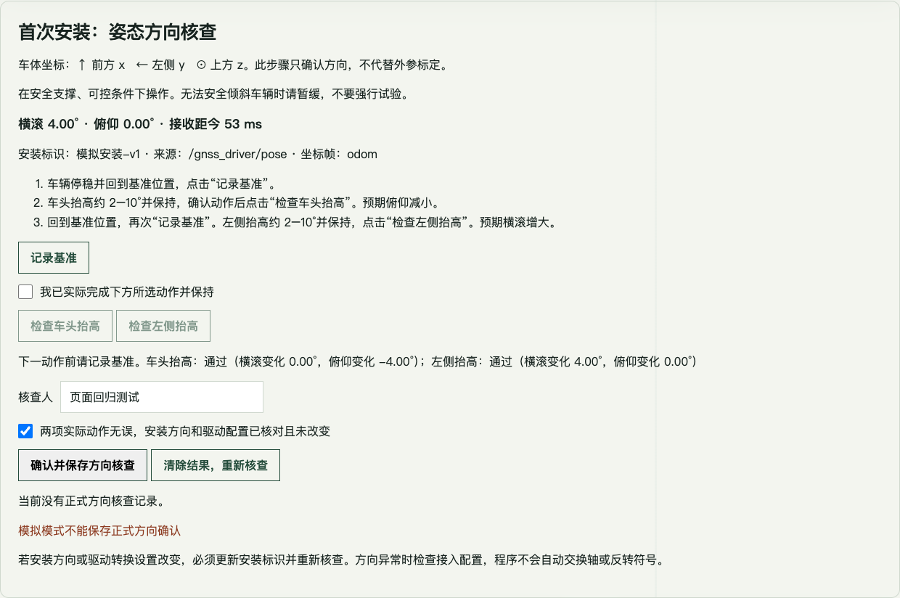

# 首次安装：在标定页面核对姿态方向

这是方向核查，不是相机外参标定，也不会自动打开动态 BEV。

## 现场操作

1. 打开田间标定台，在“首次安装：姿态方向核查”查看实时横滚、俯仰、安装标识。
   显示“姿态不可用”时先请部署人员检查连接，不要填写猜测值。
2. 在安全支撑、可控条件下，让车辆停稳并回到基准位置，点击“记录基准”。
3. 车头抬高约 2–10°并保持。勾选“我已实际完成下方所选动作并保持”，
   点击“检查车头抬高”。结果应为俯仰减小；明显横滚变化、幅度过小或方向相反会判为不通过。
4. 回到基准位置，再点一次“记录基准”。左侧抬高约 2–10°并保持，勾选动作确认，
   点击“检查左侧抬高”。预期横滚增大。
5. 两项都通过后填写核查人，核对安装和驱动配置，勾选复核并点击“确认并保存方向核查”。
   查看“当前安装已保存方向核查”。模拟模式不能保存正式确认。
6. 动作失败可以回到基准重新检查；安装方向或驱动转换改变时，部署人员必须更新安装标识，
   再“清除结果，重新核查”。不方便安全倾斜整车时，暂缓动作检查，不能把放平等同于确认。

页面角度单位是度，消息内部使用弧度。变化检查只判断轴向、符号和主要变化方向，
不是精密角度精度验收，不会自动交换轴或反转符号。

## 部署人员接入

ROS 桥接器与页面服务必须运行在同一台主机，使用同一份实时文件。
桥接器用已加载 ROS 和 weeder_msgs 的系统 Python，页面仍使用自己的 OpenCV Python 环境。
先加载 ROS 与本项目安装环境，再启动（以普通 colcon 隔离安装为例）：

```sh
source /opt/ros/humble/setup.bash
source install/setup.bash
python3 install/row_nav_calibration/bin/row-nav-attitude-bridge \
  --installation-id vehicle01-gnss-mount-v1 \
  --output "$HOME/.local/share/laser_weed/calibration/attitude/live.json"
```

另一个终端启动标定页面，原启动命令不变，默认读取上述文件。
如果设置了 ROW_NAV_CALIBRATION_DATA 或 --workspace，桥接器输出也必须改到相应目录；
也可以用页面参数 --attitude-file 明确指定。
默认订阅 /gnss_driver/pose、检查 frame_id=odom，可用 --topic 和 --frame 配置。
桥接器只订阅，不发布车辆控制，不修改 GNSS 驱动。

检查条件：一个发布者、valid=true、源时间差不超过 200 ms、接收距今不超过 1 s、
有限角度且范围合理、前向速度绝对值不超过 0.05 m/s。速度检查不能独自证明完全静止；
操作人员仍需确认车辆停稳。源时间回退会锁定故障，需要检查时钟并重启桥接器。
这些是安装方向检查的门槛，不替代运行端每帧的 50 ms 姿态时效检查。

结果保存为数据目录下 attitude/direction-review.json，包含安装标识、消息来源、
核查人以及两个动作前后的姿态证据。页面重启保留结果；重新记录基准立即使旧确认失效。
修改安装或驱动参数必须更新 installation-id，软件不能自行感知物理安装改变。

## 验证边界

本次新增部分在本地通过 Python 和浏览器模拟测试。真实 ROS 订阅及现场倾斜动作尚未验证。
本步骤没有实现标定照片与姿态的精确同步、相机六自由度求解或动态 BEV 参数发布；
这些仍是后续标定链路工作。保存方向核查不会修改运行端 vehicle_axes_confirmed 等开关。

本地验证：54 项 Python 测试、2 项页面重试测试通过；Chrome 实际按钮流程通过，
包括两方向检查及模拟保存拦截。页面截图使用模拟输入，不代表实机验收。


