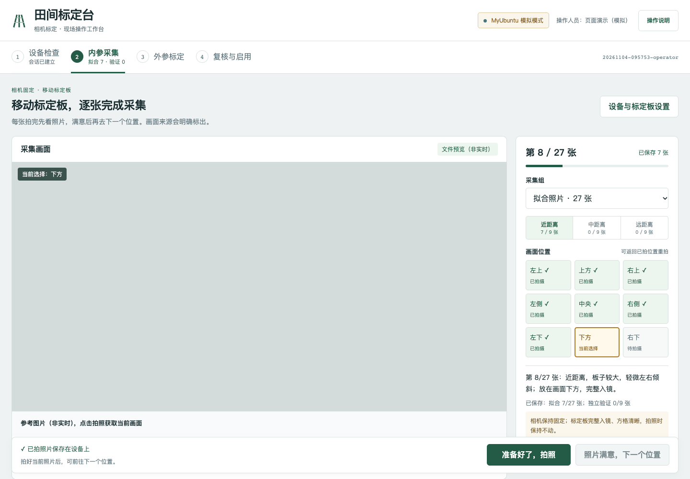
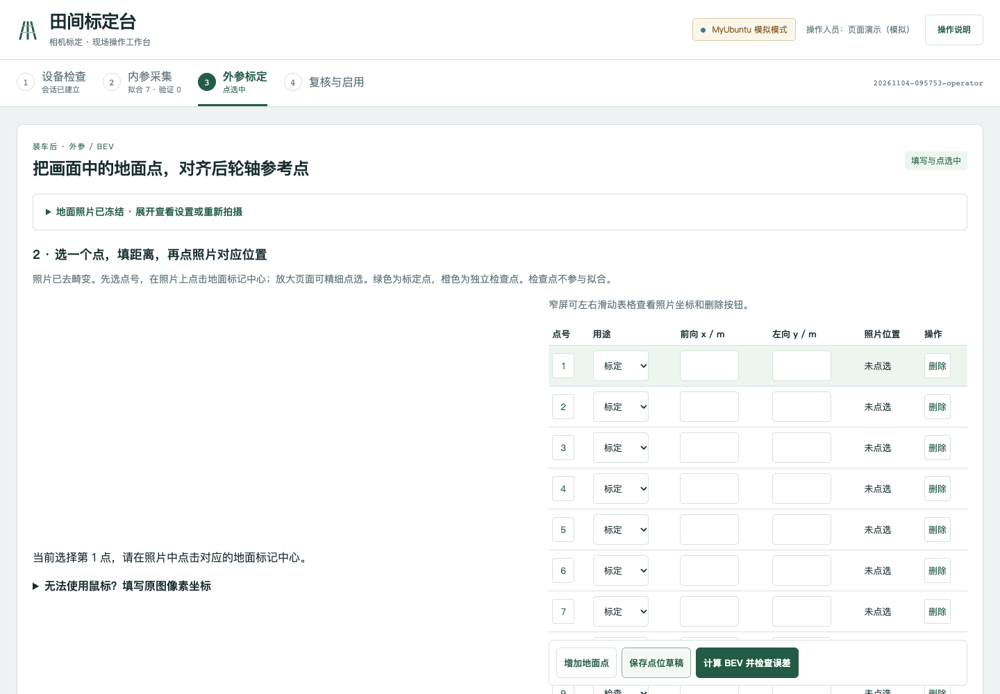
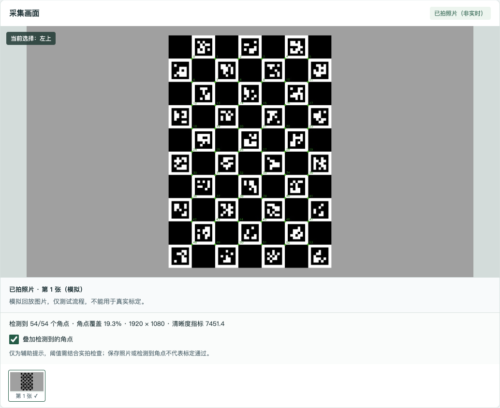
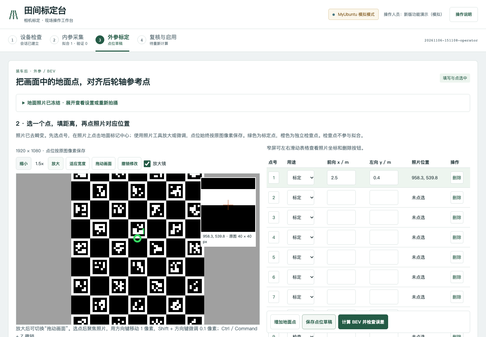

# 标定工作台操作说明

新版页面按“设备检查 → 内参采集 → 外参标定 → 复核与启用”组织。顶部导航可随时返回已经开始的步骤，切换步骤不会清空照片或点位。首次进入且没有会话时，先建立会话；再次进入会恢复当前浏览器保存的步骤。

以下截图来自实际运行的新版页面，使用模拟输入展示操作布局，不代表真机标定结果。

## 设备检查

1. 查看相机输入状态。右上角会明确显示模拟模式或硬件模式。
2. 填写操作人员，核对横向方格、纵向方格、标记边长及校验线尺寸，确认标定板已平整固定。
3. 点击“开始新会话”，页面进入内参采集。已有会话需继续时，直接点击顶部“内参采集”，无需另建会话。
4. “首次安装：姿态方向核查”位于本页折叠设置中。动态 BEV 使用前按提示完成；普通内参采集不要求执行倾斜动作。

## 内参采集

- 左侧是大画面，右侧是采集组、近中远轮次和九宫格，底部是拍照与下一位置按钮。
- 画面来源会标明“参考图片（非实时）”或“已拍照片”。参考图不会自动变成实时视频；点击拍照获取当前帧后再检查。
- 九宫格表示标定板在相机画面中的位置。绿色 ✓ 表示文件已保存，不表示检测或标定已经合格；橙色边框表示当前选择。
- 相机固定，移动标定板，按提示改变位置、距离和倾斜角度，完整入镜、保持清晰。点击“准备好了，拍照”，检查大画面后再点击“照片满意，下一个位置”。
- 当前轮次的已拍照片显示在画面下方。点击缩略图或已拍位置，可查看原照片并重拍；只替换所选照片。
- 拟合照片完成后，将“采集组”切换为“独立验证”，重新摆放采集。最后一张拍好后切换组或计算，无需再点下一位置。
- 点击工作区下方“使用本次照片计算内参”。查看可用照片与误差；失败时按问题照片列表“去重拍”，可在本会话重试。已有离线图片可展开“已有照片？从部署目录导入”。

完整照片数量不保证标定合格，仍需检查检测结果、独立验证误差以及图像效果。候选内参不会自动启用。

## 外参标定

1. 点击顶部“外参标定”。车辆停稳、相机固定装车，在平整地面布点并实测坐标。
2. 展开“地面拍照与参考设置”，确认原点是后轮轴中心的地面垂直投影，前向 x 为正、左向 y 为正，选择并复核所用内参。
3. 如需动态 BEV，选中相应选项后填写后轴实体中心高度并确认参考坐标。需要方向核查时点击“前往首次安装姿态核查”；完成后通过顶部导航返回。静态模式隐藏这些动态字段。
4. 点击“准备好了，拍摄地面照片”。照片冻结后，设置自动折叠，直接进入点位表和照片编辑区；需要重拍时展开设置。重拍会清除该冻结照片的点位和计算结果，先保存需要的记录。
5. 选择点号，填写实测前向、左向距离，在照片上点选同一地面标记。至少 6 个标定点和 4 个独立检查点；检查点不参与拟合。
6. 中途点击“保存点位草稿”可保存未填写完整的点位。浏览器也会自动保存本地编辑；换电脑或清理浏览器前，应先保存到设备。
7. 点位完成后点击“计算 BEV 并检查误差”，计算成功会进入复核页。若输入未完成，页面保留编辑内容并提示修正。

## 复核与启用

- 查看原图点号、BEV、每点误差和动态标定摘要。几何检查通过仍需要人工复核。
- 修改任一点位后，旧结果会隐藏，并显示“待重新计算”。重新计算之前不能发布新参数。
- 只有硬件模式、所需检查通过并人工确认后，才能点击“复核后设为算法参数”。模拟结果不能发布。
- 下方“导出测试包”用于保存本次照片、点位、日志和候选参数，导出不会启用参数。
- 保存正式参数后，正在运行的算法仍使用原参数；需在下次初始化时加载新版本。页面不会自行重启车辆程序。
- 会话目录和参数读取路径在折叠的技术信息中，现场操作不需要手动填写这些路径。

## 即时照片检查与精细选点（2026-11-06）

拍完内参照片后，画面下方会显示检测角点数、角点覆盖占比和清晰度指标，并提示可能的模糊、过曝、过暗或检测区域偏小。“叠加检测到的角点”可在原照片与角点标记图之间切换。标记图单独保存，不会进入内参拟合图片集合。

这些指标仅用于帮助人工检查，数值会受相机、曝光和场景影响；阈值尚需实拍调整，不是正式验收标准。质量检查程序不可用时，原照片仍保留并提示人工复核。若画面加载失败，先点击“重试显示照片”，确认画面后才能进入下一位置。

外参照片必须加载完成且尺寸与冻结记录一致后才能选点、修改像素或计算。加载失败可点击“重试加载照片”，已填写的点位保留。

- **放大、缩小、适应宽度**：只改变显示比例，不改变已保存的原图坐标。
- **拖动画面**：放大后点击此按钮，再拖动照片；此模式不会把拖动误记为选点。再次点击退出拖动模式。
- **放大镜**：查看鼠标附近或当前所选点的原图 40×40 像素区域，可通过复选框关闭。
- **微调**：先在照片中选点，让照片保持键盘焦点，再用方向键移动 1 个原图像素，Shift + 方向键微调 0.1 像素。
- **撤销修改**：点击按钮，或在照片上使用 Ctrl / Command + Z。最多撤销最近 50 次编辑，撤销记录不跨刷新保存；点位草稿仍按原来的方式保存。撤销后也需重新计算和复核。

BEV 地面照片不会运行内参照片质量检查，以避免额外分析延迟影响曝光与姿态同步。

