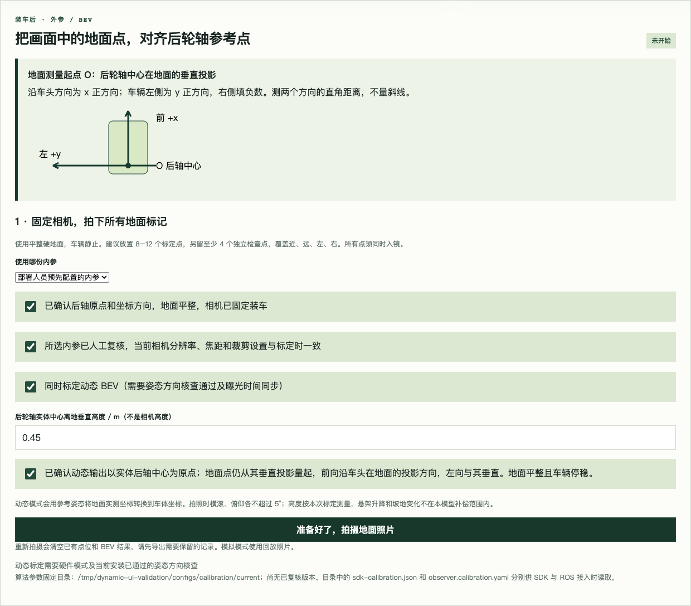

# 动态 BEV：从页面标定到运行配置

静态流程继续可用。选中“同时标定动态 BEV”时，页面在原有流程上增加同步姿态、
相机六自由度求解及运行端参数发布；不启动车辆或控制器。

## 现场流程

1. 相机固定到最终安装位置，完成内参并复核。先按“姿态方向核查”完成当前安装的方向确认。
2. 在平整地面停车，尽量水平。运行只读 ROS 姿态桥接器，让页面实时姿态正常。
3. 以实体后轮轴中心的垂直地面投影为测量起点，车头在地面上的投影为前向，
   与之垂直向左为左向。测量地面标记中心的前向、横向距离。
4. 勾选“同时标定动态 BEV”，填写**实体后轮轴中心离地的垂直高度**，不是相机高度。
   确认动态输出坐标约定。保持车辆及标记静止，点击拍摄。
5. 页面自动用照片曝光起始时间匹配之前的姿态。失败时按提示处理后重拍；
   不会退回“点击按钮时的姿态”或自动按水平处理。
6. 按原有方式填写坐标和选点，至少 6 个标定点、4 个独立检查点，建议 8+4。
   点击计算，查看相机离地高度、相对后轴中心位置、光轴朝向、重投影和地面误差。
7. 复核后保存。完整内参、BEV、外参和同步证据进入版本目录，current 原子切换。
   要让运行中的感知程序使用新参数，需以新配置重新启动。

## 坐标约定（部署前必须核对）

地面卷尺测量坐标是水平地面坐标，原点为后轴中心的垂直投影。
动态运行输出是**实体后轴中心**车体坐标系中的 x/y，x 前、y 左、z 上。
两者在车辆倾斜时不同。程序使用同步横滚/俯仰及后轴中心高度进行转换：

```
p_vehicle = R_ground_vehicle^T * ([x_ground, y_ground, 0] - [0, 0, axle_height])
R_ground_vehicle = Ry(pitch) * Rx(roll)
```

测量地面前向与车头投影对齐，航向可消去，不需要全球位置。
相机光学坐标到车体的刚体外参由平面 PnP 求出；运行端延用已有 DynamicBevProjector。
原点离地高度不是相机位置中的 z，也不是安装板的高度，不能填 0 来省略物理杆臂。
该模型保持轴心离地高度恒定，不估计悬架升降或变化的地形坡度。

发布的 ROS 覆盖文件明确设置 `vehicle_frame: rear_axle_center`，不冒充已有 `base_link`。
本模块不发布这两个坐标系之间的 TF，也不修改控制器。集成人员必须核对下游使用的参考点，
避免重复做后轴/轴距补偿。

## 时间与检查条件

- C++ 采集保存 V4L2 的 CLOCK_MONOTONIC 曝光起始时间及照片 SHA256。
- 只接受驱动明确标记 MONOTONIC + SOE 的时间戳；EOF、未知时钟或旧版采集程序会阻止动态标定，静态拍照仍可用。
- 桥接器在同一主机保存最近 512 条姿态，用 ROS 当前时间与本机 monotonic 的对应关系映射消息时间。
  禁用模拟时间；消息时钟回退/异常会阻断有效姿态。
- 选择曝光之前最近一条姿态，时间差 ≤50 ms；不跳过更新的无效样本去使用旧样本。
- 曝光前约 0.5 s 至少有 5 条、覆盖至少 0.3 s 的稳定记录：姿态波动 ≤0.5°、速度 ≤0.05 m/s。
  参考横滚/俯仰各 ≤5°；这些检查不代替现场确认停稳。
- PnP 只使用标定内点，检查点不参与求解；相机须在地面上方、标记须在相机前方。
- 重投影 RMSE ≤3 px，动态独立地面检查 RMSE ≤5 cm、最大 ≤10 cm；
  与实测 BEV 在 SDK 使用的 1/3/5 m 参考网格上偏差 ≤5 cm。
- 保留运行端保守姿态变化范围 0.035 rad 和 50 ms 时效，未经实车验证不自动放宽。

## 运行端加载

普通安装后加载 ROS 环境及工作区，使用原有模型/图像配置，并在其后叠加标定配置：

```sh
ros2 launch crop_row_perception observer.launch.py \
  config:=/absolute/path/to/observer.yaml \
  calibration:=$HOME/.local/share/laser_weed/calibration/runtime/current/observer.calibration.yaml
```

覆盖文件同时启用 SDK 对应的动态模式和姿态检查，写入参考姿态、消息来源及方向确认。
基础配置仍负责模型、图像话题等内容。C SDK 用户读取同目录 sdk-calibration.json 的路径。
标定输出中的每个路径固定到不可变版本；迁移主机时应在目标机重新发布。
静态标定的覆盖文件明确关闭动态模式，避免沿用旧开关。

## 验证范围

Python 合成测试覆盖已知外参恢复、非零参考姿态、倾斜后的独立三维投影对照、
错误检查点、曝光时间匹配、过期/无效/运动/改变安装等拒绝条件，以及完整准备、计算、发布和篡改拦截。
本地软件测试不代表整车精度验收。
MyUbuntu 当前 SSH 仍不可达；C++ 新采集程序编译、V4L2 SOE 支持、ROS 实际时间源、
完整 SDK 加载和实车动态补偿仍需在目标环境验证。尤其不能默认当前相机驱动提供 SOE。

本次回归：67 项 Python 测试、2 项页面重试测试和 6 项构建入口测试通过。
Chrome 实际点击验证动态模式拒绝模拟姿态，随后切回静态模式仍能拍照。


