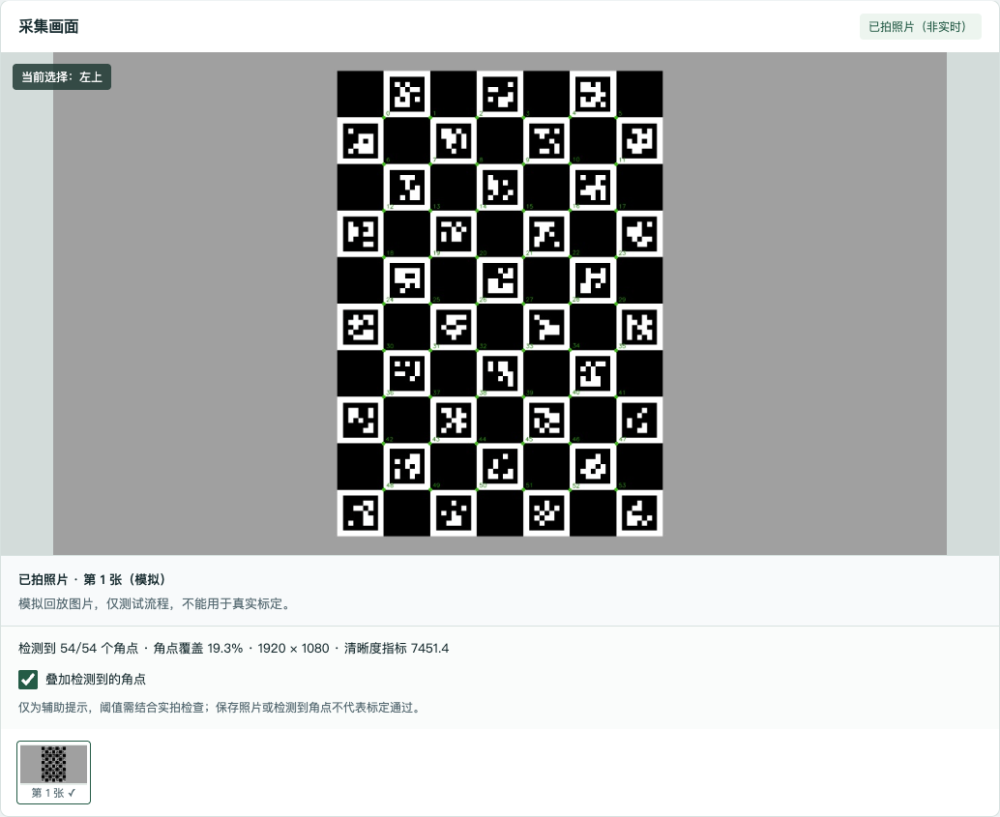
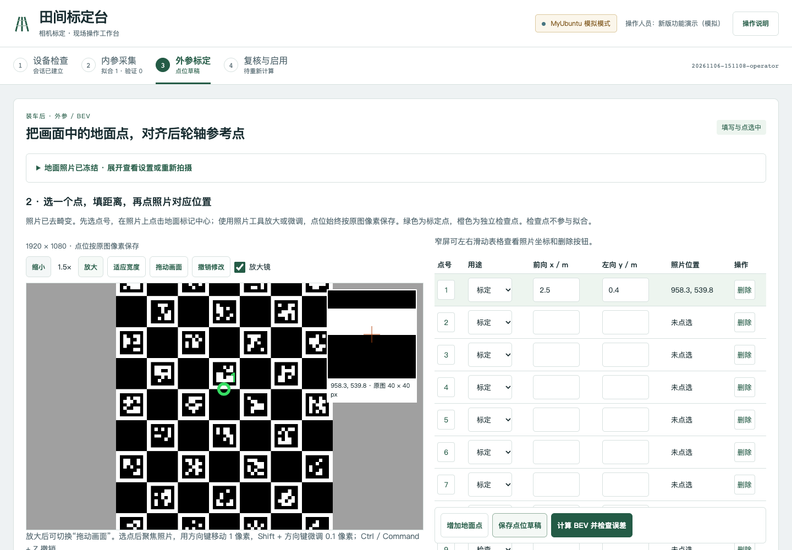

# 照片加载保护、精细选点与即时质量检查验证

日期：2026-11-06。改动基于 `2eb9b74`；范围为标定页面、照片辅助诊断和测试，没有修改 SDK 几何接口、车体参考坐标或车辆控制。

## 已实现

- BEV 照片加载前禁用选点、像素更新和计算。加载失败原位重试，保留已编辑点位；像素尺寸必须与冻结记录一致，旧请求晚到不会解锁新照片。
- 初始会话响应晚到时保留用户已手动选择的步骤，不打断当前填写。
- 显示比例 1–8×、拖动模式、原图 40×40 像素局部放大镜、方向键 1 像素及 Shift+方向键 0.1 像素微调，最多 50 次内存撤销。缩放只改变显示，坐标始终对应原图。
- 内参照片保存后由独立校准 Python 执行角点检测与辅助指标计算，返回角点数、检测区域占比、清晰度及极端曝光提示，可切换原图和角点叠加图。
- 诊断失败时保留照片、显示人工复核提示并记录日志。叠加图不进入照片计数或训练输入，原始照片与曝光时间侧录不被诊断改写；BEV 拍照跳过此诊断，以免影响姿态同步。
- 辅助提醒阈值为角点少于 12、Laplacian 方差低于 40、纯白或纯黑像素占比大于 65%、检测角点凸包占比低于 2.5%。它们不是内参拟合或正式发布条件，需结合实拍调校；不能把检测到角点或保存了照片当成通过标定。

0.1 像素是编辑步长，不是测量准确度承诺。鼠标事件还受显示像素量化影响，最终按独立检查误差验收。

## 已完成验证

- Python：77 项通过；新增测试覆盖完整 ChArUco 角点、模糊和极端曝光提示、不可解码图片、原始字节保留、叠加图不进入训练/计数、诊断程序故障隔离，以及 BEV 跳过诊断。
- JavaScript：7 项通过；新增测试覆盖加载/失败/尺寸异常时禁止改点、过期响应隔离、重试保留编辑、撤销后仍要求重算。
- MyUbuntu 纯页面 CMake 安装与 CTest 两组通过。校准环境 OpenCV 4.14.0、NumPy 2.2.6；没有替换系统 OpenCV。
- 实际浏览器连接 MyUbuntu 安装版：原有恢复与计算流程通过；新增测试验证照片显示失败重试、辅助报告和角点叠加、BEV 延迟/失败加载保护、缩放不改变已选坐标、放大后点击仍按原图坐标换算、0.1 像素键盘编辑、撤销、拖动不误选以及 390px 窄屏无横向溢出。未发现页面 JavaScript 错误。
- 桌面、窄屏及照片叠加图已人工查看截图。静态检测发现的低对比度、过小文字及旧边框样式已调整；无 src 的图片标签用于等待真实 API 数据，实际运行中按加载状态隐藏/显示，没有替换为占位假图。

远端隔离验证与演示目录：`/home/zhouboyang/workspace/calibration-precision-20261106`。纯页面安装使用 `ROW_NAV_CALIBRATION_BUILD_CAPTURE=OFF`，不代表重做了 C++/ARM64 构建或真机采集验证。

浏览器回归入口：`tests/browser/test_operator_recovery.cjs` 和 `tests/browser/test_precision_quality.cjs`；两者须顺序连接同一个独立模拟服务，测试会建立会话。后者需要可解码的模拟图片和正确的校准 Python。

## 实际页面截图（模拟输入）

软件流程已验证；照片质量阈值、真实镜头效果和装车几何精度仍需现场实拍与独立点检查。
