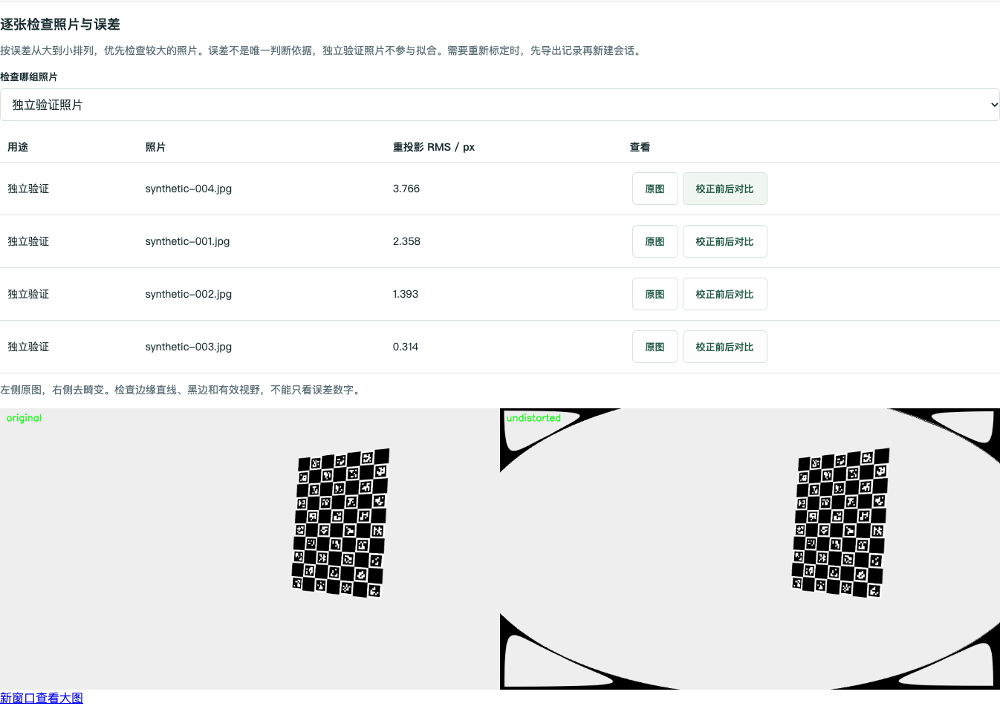
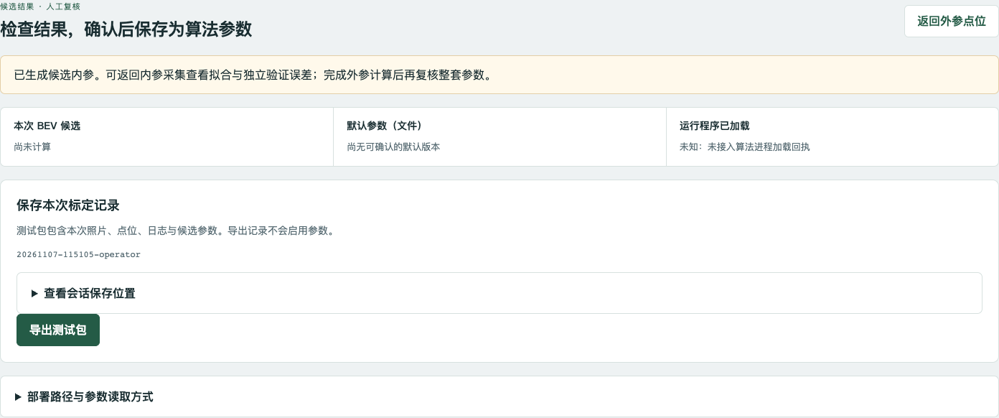

# 内参报告、参数状态与小图缓存验证

日期：2026-11-07。基于 `9ffcef7`，范围为标定工具，不修改 SDK/C++、ROS 驱动或车辆控制。

实现：

- 校准摘要保留拟合照片逐图误差与身份，页面展示按误差排序的拟合/独立验证照片，提供原图及独立验证校正对比。映射使用被采用照片的原始文件名；拒绝图不会导致后续对比图索引错位。旧报告只有在全部图可用时才兼容误差列表，不猜测被拒绝照片的身份。
- 发布记录包含当前候选五个关键文件的 SHA256 指纹。复核页区分本次候选、文件默认版本与运行加载状态；无算法加载回执时始终未知，不从文件或任意 loaded 字段推断运行态。
- 每次拍照产生独立版本；最长边 192px 的 JPEG 小图使用该版本命名，并在小图就绪后原子更新版本指针。带当前版本的缩略图提供私有 immutable 缓存及 ETag/304；过期版本请求不缓存新内容。原图和角点图保持 no-store。
- 前端保留缩略图节点和未变化图片 URL，重拍仅替换对应 URL；刷新后，当前正在查看的照片也按版本更新。所有小图均从拟合输入及照片计数中排除。
- 修复合成测试板生成器在 OpenCV 4.14 的非零内边距问题；模拟板生成和照片渲染只用于流程测试，与实际打印板无关。

验证：本地 Python 81 项、JavaScript 7 项通过。新增 Python 覆盖逐图身份及拒绝图映射、路径限制、旧报告兼容、小图尺寸与缓存/304/重拍版本、候选指纹状态和无回执时保持未知。三组浏览器回归入口为 `test_operator_recovery.cjs`、`test_precision_quality.cjs`、`test_report_cache.cjs`，须顺序连接同一隔离模拟服务。

`test_report_cache.cjs` 使用真实校准程序运行 12 张拟合、4 张独立验证的合成透视图片；核对报告张数/误差排序、原图与 3840px 对比图、节点保留、单张重拍失效以及运行态未知。此处仅验证软件流程，不能用于相机内参、田间识别或装车精度验收。

操作说明见 [标定工作台操作说明](calibration-workbench.md)。

MyUbuntu 安装版复测：隔离目录 `/home/zhouboyang/workspace/calibration-review-20261107`，OpenCV 4.14.0。CMake 安装后 CTest 两组通过（Python 81 项、JavaScript 7 项）；三组浏览器回归均通过，无 JavaScript 错误。最终后端重启后再次运行报告/缓存回归通过。安装配置关闭相机采集编译，因此不代表硬件采集、交叉编译或板端验证通过。

