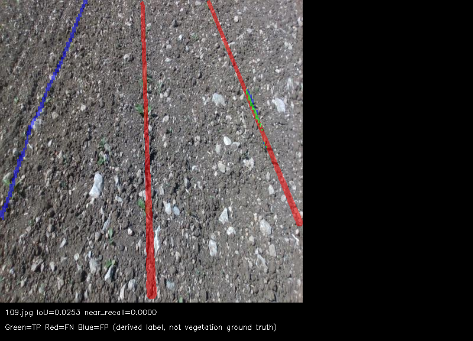

# 真实模型分割定量检查（2026-11-12）

结论：当前模型与这版派生标签的一致性较低，不足以支持“识别精度够用”的判断。完整实例mask路径没有改善，不能把问题主要归因于快速合并路径；仍需核对原始权重/导出推理的一致性以及标签质量，不能直接判定模型架构不适用。

## 数据与条件

- 模型：crdld-yolo11n-seg-tracked-v1-100e-rknnopt.onnx，SHA256 `dc2b3f1a25642e131484de03b42fc8bdd0d787a3198bf068df7933109f4a7480`。
- 数据：当前 crdld-yolo-seg-tracked-v1/images/test 的全部430张；不是官方完整测试划分覆盖率声明。430与此前描述的500张之差尚未审计。本次没有检查训练/测试图像重复，也未重新追溯权重转换链。
- 标签：同目录labels/test单类YOLO多边形，来自原始行标注拆分/拓宽，非人工植被像素真值。已有训练args.yaml指向同一dataset.yaml、100轮；仅作配置来源证据。
- 转换报告记录远端宽6、近端宽18、gap2、epsilon0.5，test有1541个实例、1027条分支被丢弃，输出对原始前景覆盖率74.84%。这些是转换报告的历史统计，不是本次模型指标，也未复算转换过程。
- 两次均640输入、阈值0.25、最多16实例，ONNX CPU/OpenCV4.5.4；仅切换fast/full重建路径。核对模型hash与430张输入hash逐项相同。两次运行二进制hash不同（增加模式开关后重建），未做重复多轮性能实验。

## 结果

| 指标 | fast（当前SDK路径） | full（完整实例mask） |
|---|---:|---:|
| micro像素IoU | 20.36% | 20.20% |
| macro逐图IoU | 20.93% | 20.80% |
| 像素precision | 54.09% | 55.84% |
| 像素recall | 24.62% | 24.04% |
| 像素F1 | 33.84% | 33.61% |
| 近端像素recall | 20.78% | 20.17% |
| 覆盖不到50%的标签多边形 | 1268/1541 | 1282/1541 |
| 整图完全漏检 | 0/430 | 0/430 |
| CPU infer均值 / P95 | 49.03 / 52.12ms | 50.98 / 54.03ms |

非空mask为430/430仍不能说明够用。多边形覆盖<50%是预先指定的区域诊断，不是实例检测召回/mAP。近端定义为图像底部三分之一，不是固定地面距离。速度包含预处理、执行和解码，首次冷帧包含在内，不含读写，非板端NPU性能。

## 计算方式与复现

新增evaluate_masks.py：逐图按图像宽高还原归一化polygon，四舍五入到像素并填充，所有实例取并集；预测必须是同尺寸uint8的0/255图。计算TP/FP/FN，micro按像素汇总，macro对有定义IoU的图片平均。空预测有GT记为漏检；双方空的IoU为null，不计入macro。缺标签文件直接报错，不当成背景。无容差膨胀，也不自动改标签来提高分数。每张记录输入、标签和预测hash，摘要记录推理manifest hash。

```bash
python3 evaluate_masks.py --run /absolute/segmentation-run \
  --labels /absolute/dataset/labels/test --output /absolute/new-metrics
```

inspect_segmentation.py 新增 --mask-mode fast|full。结果输出per-image.json、summary.json以及IoU最差和近端召回最差各12张的并集图册。红=FN，蓝=FP，绿=TP，均相对于派生标签。

MyUbuntu完整目录：workspace/sdk-replay-20261112 下的 real-seg-430-v1、real-seg-430-full-v1、metrics-430-v2、metrics-430-full-v2。仓库存两份摘要、转换报告和一个最差样例，不重复保存430张原图和mask。

[fast摘要](mask-evaluation-20261112/fast-summary.json)、[full摘要](mask-evaluation-20261112/full-summary.json)、[标签转换报告](mask-evaluation-20261112/conversion-report.json)。



抽查最差样本109.jpg、102.jpg，可见整段标签未覆盖、行带错位及碎段；没有穷尽审查全部图片或对失败原因完成归因。

验证：六组CTest通过，新增已知像素混淆矩阵、近端ROI、空预测、缺标签、NaN和输入hash改变测试。下一步优先做PyTorch原始权重与ONNX导出一致性对照，再决定修导出、标签或训练；本次不改正式模型和默认后处理路径。
