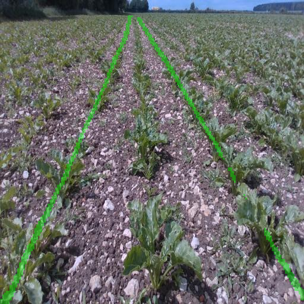

# 离线回放与评测

工具直接通过公开 C ABI 调用同一份 SDK，不另写推理或选行算法。不依赖 ROS。需要 Python、NumPy、opencv-python；库的 OpenCV/RKNN 依赖仍由系统安装。SDK 至少需要含诊断接口的 0.2.1。

```bash
python3 row_nav_sdk/scripts/evaluate_replay.py \
  --library /absolute/install/lib/librk_row_nav.so \
  --model /absolute/model.onnx --backend onnx \
  --intrinsics /absolute/intrinsics.yaml --bev /absolute/bev.yaml \
  --input /absolute/images_or_video --output /absolute/new-run-directory \
  --fps 15 --limit 300 --warmup 10 --overlay-every 10
```

安装后脚本位于 tools/，与 summarize_diagnostics.py 放在同一目录。输出目录必须不存在，不混入历史结果。图片目录仅读取第一层并按文件名字典序排序，建议补零命名；不相关的图片应增加 `--independent-images`，每张重建 handle 并关闭跳变统计。该模式初始化时间不包含在 SDK 帧耗时内。视频逐帧解码；视频中途解码失败可能被解码器当作结束，需核对实际帧数与预期。

- frames.jsonl：包括预热的逐帧输入身份、返回码、状态、导航结果和阶段计时；不可用数值用 null，异常不沿用上一帧结果。
- timing.csv：去除预热的计时，可再次运行 summarize_diagnostics.py。available=0 样本不纳入耗时统计。
- summary.json：有效帧率（比例）、状态计数、连续有效相邻帧的跳变次数及各阶段均值/P50/P95/最大值。跳变阈值默认 0.15m、5°，可通过 --jump-m/--jump-deg 修改。无效帧会打断相邻关系，预热和独立图片不参加时序跳变统计。状态计数的负数是 SDK 错误码，非负数为 observation_status。
- overlays/：原图上标注导航数值和状态。当前 C API 不提供 mask 或像素线，叠加图仅为结果注释，不画伪造分割轮廓。
- manifest.json：模型、库、内外参及输入指纹、SDK 版本、运行选项和完成标记。目录图片指纹逐张记录在 frames.jsonl；视频记录整个文件指纹。completed=false 为未完成，不能作为完整评测结果。

`--fps` 控制回放提交间隔，推理慢时不会丢帧赶进度。时间戳由 SDK 单调时钟在提交时生成，不是原始曝光时间；时序跟踪使用实际回放时刻，跨设备/负载会有差别。总耗时是 SDK 调用耗时，不含解码、文件哈希、叠加图写盘和主动等待；不能用 1000/P95 宣称系统帧率。--max-age-ms 默认250，超时帧会保持 STALE；不要为提高有效率而隐藏修改此阈值。

本版只接受已通过 SDK 检查的静态 BEV 参数。动态 BEV 需要原始曝光与姿态的配对记录，工具目前明确拒绝，不模拟真实同步。没有地面真值时，有效率与跳变不等于横向/航向精度。公开数据缺少当前相机标定时，不能用任意 BEV 参数宣称车辆坐标准确。

## 2026-11-12 验证

MyUbuntu 隔离目录 `/home/zhouboyang/workspace/sdk-replay-20261112`。集成测试使用仅测试构建的 `librk_replay_test_sdk.so`，通过真实 C ABI、去畸变及几何链路，替换神经网络输出；该库不安装发布。覆盖图片/视频、预热剔除、已知0.1m偏移、无行无效值、诊断统计、覆盖写入拒绝、坏图片未完成记录。不能将这些结果当作真实模型精度或 NPU 性能。

可在 CMake 配置 `ROW_NAV_REPLAY_TEST_PYTHON` 为具有 cv2/numpy 的解释器，将 sdk_replay 加入 CTest。该选项仅用于主机且 RKNN=OFF 的测试构建。

本次五组 CTest 全部通过，安装到独立前缀后的脚本也通过同一图片/视频集成测试；人工查看了结果注释图。报告与测试图片保存在上述隔离目录的 test-artifacts/，属于合成软件测试数据。

## 无相机标定的真实模型检查

新增可选工具 segmentation_replay（`-DROW_NAV_BUILD_TOOLS=ON`），直接复用 SDK 的 ONNX/RKNN Segmenter 和同一解码器，跳过需要测量标定的去畸变/BEV/选行，不修改 calibration_valid，也不生成虚构车辆坐标。支持单层图片目录。它导出实际 mask、绿色半透明叠加图、原始图片路径及逐帧实例数、mask 占比、完整 infer 调用耗时。耗时含预处理/执行/解码，不含图片读写；这不是正式导航 SDK 的端到端耗时。

```bash
python3 row_nav_sdk/scripts/inspect_segmentation.py \
  --binary /absolute/build/segmentation_replay --backend onnx \
  --model /absolute/model.onnx --input /absolute/public-images \
  --output /absolute/new-segmentation-run --limit 50
```

包装脚本保存模型、二进制与逐图 SHA256、运行日志、汇总和完成状态。不做随机抽样、预热剔除或置信度阈值搜索；默认配置为640输入、单类、检测阈值0.25、最多16个实例、快速合并mask路径。首次冷推理包含在统计中。图片列表互相独立，不能从本次结果声称时间连续稳定性。

2026-11-12 实际使用已有 `crdld-yolo11n-seg-tracked-v1-100e-rknnopt.onnx`，从已存在 CRDLD 派生数据目录 `images/test` 按文件名排序取前50张，ONNX CPU/OpenCV 4.5.4 回放：50张完成，0解码失败，50张非空mask；平均48.816ms、P50 48.371ms、P95 50.884ms、最大62.468ms。这是单次本机结果，不是RK3576/RK3588 NPU速度，也不是分割正确率。本次使用的是已训练的 YOLO11 权重，并未重新训练或改为 YOLOv8。

抽查第0、25、49张叠加图：能输出行带；部分近端行段存在缺失、边缘不连续，不能仅凭非空mask判定识别可靠。尚未进行全量人工审查、标注IoU统计或实际稻田域验证，不据此更改模型选型。

完整输出保存在 MyUbuntu `/home/zhouboyang/workspace/sdk-replay-20261112/real-seg-50-v2`。仓库仅存汇总、可复现指纹与一张示例：[summary](replay-20261112/summary.json)、[manifest](replay-20261112/manifest.json)。五组现有CTest再次通过。本次新增的是离线mask导出工具，公开C接口仍只返回导航结果，尚未增加通用调试结果接口。


